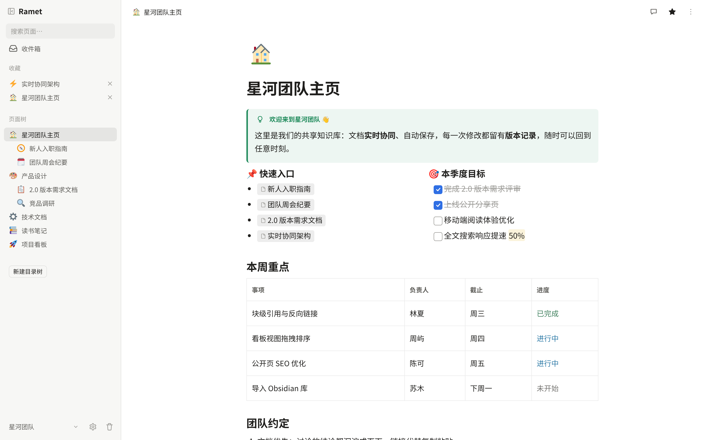
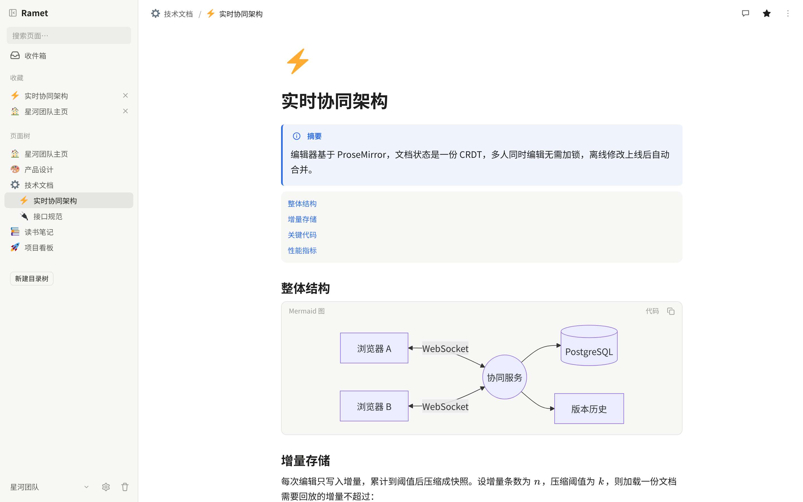
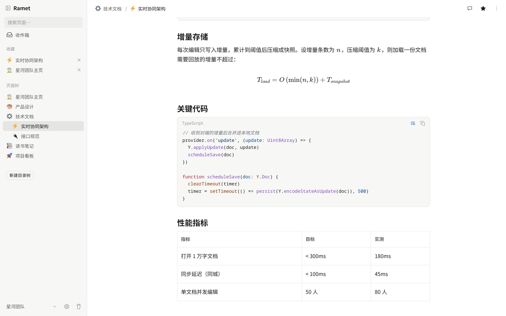
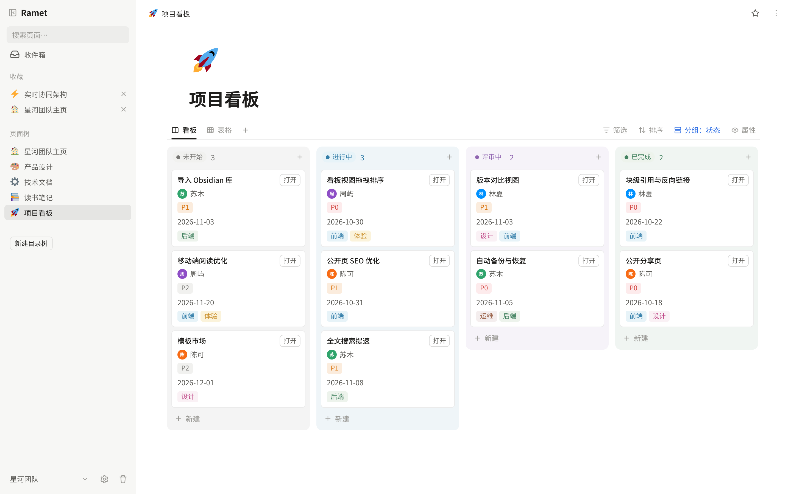
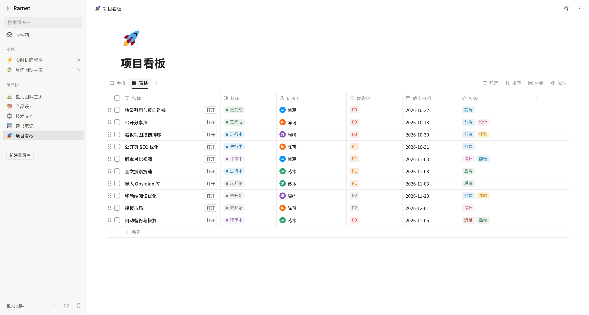
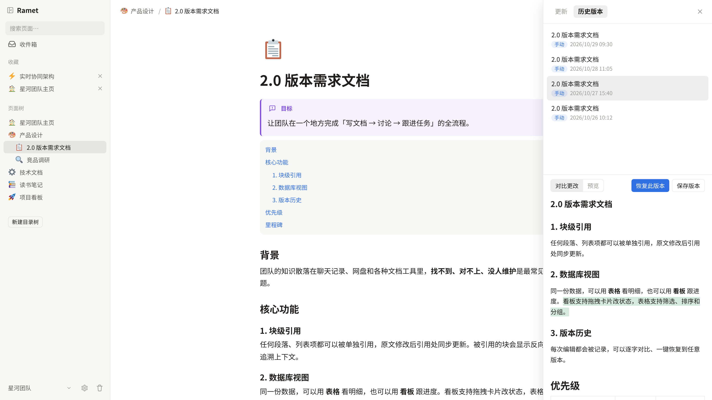
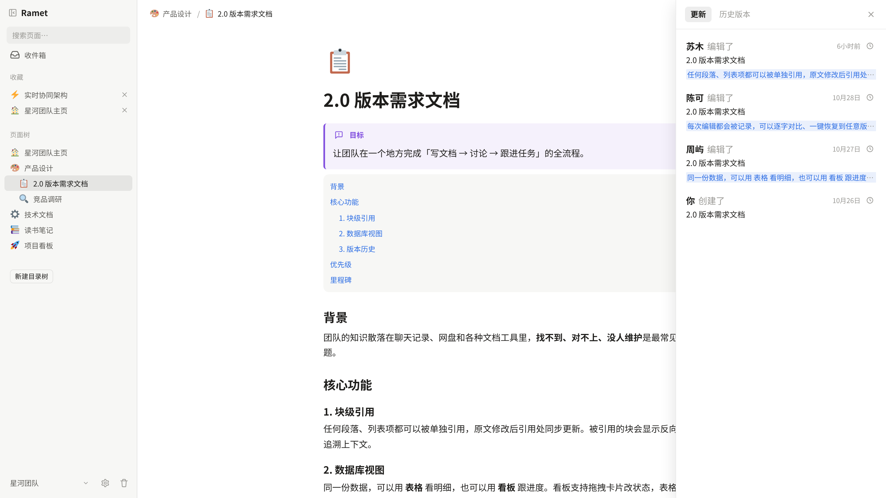
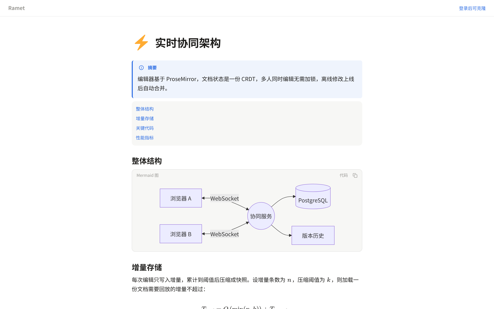
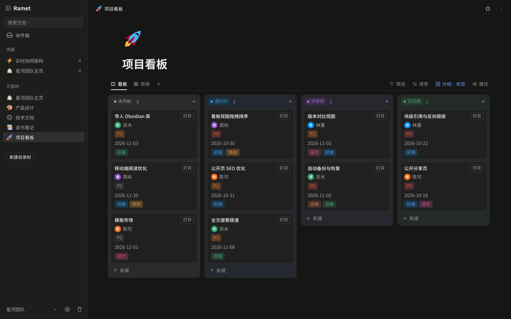

<div align="center">


# Ramet

**A self-hosted, collaborative Markdown knowledge base**

Page tree · Block editor · Real-time collaboration · Permanent version history · Your data in your own Postgres


**English** · [简体中文](README.zh-CN.md)

[Features](#features) · [Deploy](#deploy) · [Configuration](#configuration)

</div>

<p align="center">
  
</p>

---

## Features

### ✍️ A block editor that speaks Markdown

- Milkdown-based block editor: `/` slash menu, drag handles, tables, code blocks with highlighting, math, Mermaid diagrams, callouts, images & attachments, sub-pages, synced blocks
- Source mode: edit a whole page as raw Markdown
- Real-time multiplayer editing on Yjs, with live cursors
- `@` page mentions, `[[` wiki links, block links and backlinks; stable block ids keep links intact when the Markdown is rewritten

<table>
<tr>
<td width="50%"></td>
<td width="50%"></td>
</tr>
</table>

### 🌲 Page tree or folder tree — or both

- **Page tree**, Notion-style: pages nest inside pages, and every page can have both content and children
- **Folder tree**, Obsidian-style: plain folders that hold documents and uploaded files
- Each space has both side by side; use whichever fits, drag to reorganize

### 🗂 Collections: tables and boards

- Turn a page into a collection and view it as a table or a board
- Filter, sort, group, bulk actions; drag cards between columns

<table>
<tr>
<td width="50%"></td>
<td width="50%"></td>
</tr>
</table>

### 🕰 Every version, kept forever

- Snapshots are never deleted; block-level diffs, compare any two versions
- Restore a whole version, or bring back just one deleted block
- An activity feed shows who changed what

<table>
<tr>
<td width="50%"></td>
<td width="50%"></td>
</tr>
</table>

### 🌐 Share it, own it

- Spaces and members (owner / member / viewer), invite links, favorites, trash, full-text search
- Publish a single page publicly, no login required
- Export to zip (one `index.md` per page plus its assets) / import Markdown
- Dark mode, works on mobile

<table>
<tr>
<td width="50%"></td>
<td width="50%"></td>
</tr>
</table>

## Deploy

You only need **Docker**. The image bundles the frontend and the server; Postgres runs next to it.

```bash
mkdir ramet && cd ramet
curl -fsSLO https://raw.githubusercontent.com/nsjsv/Ramet/main/docker-compose.prod.yml
curl -fsSL https://raw.githubusercontent.com/nsjsv/Ramet/main/.env.example -o .env
# edit .env as needed (see Configuration); at least change POSTGRES_PASSWORD
docker compose -f docker-compose.prod.yml up -d
```

Then:

1. Open `http://<server>:8080`. **The first visit shows a setup page where you create the admin account.** Do this right after deploying.
2. The admin creates other accounts from the admin panel (there is no self-registration), then invites them into spaces.

One port serves the pages, the API and the WebSockets. To put it on a domain with HTTPS, point your reverse proxy (nginx, Caddy, ...) at that port for the whole site; it must pass the `Upgrade` header through on `/collab`, `/term` and `/connector`, and set `X-Forwarded-Proto`.

To build the image yourself instead, clone the repository and run `docker compose -f docker-compose.prod.yml up -d --build` in it.

### Upgrade

```bash
docker compose -f docker-compose.prod.yml pull
docker compose -f docker-compose.prod.yml up -d --remove-orphans
```

The database schema is updated automatically on startup; there are no manual migrations. `--remove-orphans` stops the separate nginx container that older versions used.

### Backup

All data lives in two directories: `./postgres-data` and `./uploads`. Uploaded files are never deleted, because older versions still reference them.

## Configuration

Set in `.env` at the repository root; everything is optional. See [`.env.example`](.env.example).

| Variable | Purpose |
|---|---|
| `POSTGRES_PASSWORD` | Database password. Only applied when the database is first created; change it inside Postgres afterwards |
| `WEB_PORT` | Public port, default `8080` |
| `RAMET_IMGBED_URL` / `RAMET_IMGBED_TOKEN` / `RAMET_IMGBED_PUBLIC_URL` | Optional: mirror images to a [CloudFlare-ImgBed](https://github.com/MarSeventh/CloudFlare-ImgBed) instance and redirect image reads there; the local copy remains the original |

## Contributing

See [CONTRIBUTING.md](CONTRIBUTING.md) for development setup and commit conventions.

**AI-generated issues and pull requests are welcome, but must be labeled.** If an AI wrote your issue or PR (fully or mostly), end its description with a line saying so, e.g.:

```
AI-generated (Claude Code)
```

## Friends

- [LINUX DO](https://linux.do/) — a sincere, friendly and vibrant tech community.

## License

[AGPL-3.0](LICENSE). Emoji images from [Twemoji](https://github.com/twitter/twemoji) (CC-BY 4.0, see `packages/web/public/twemoji-NOTICE.txt`).
