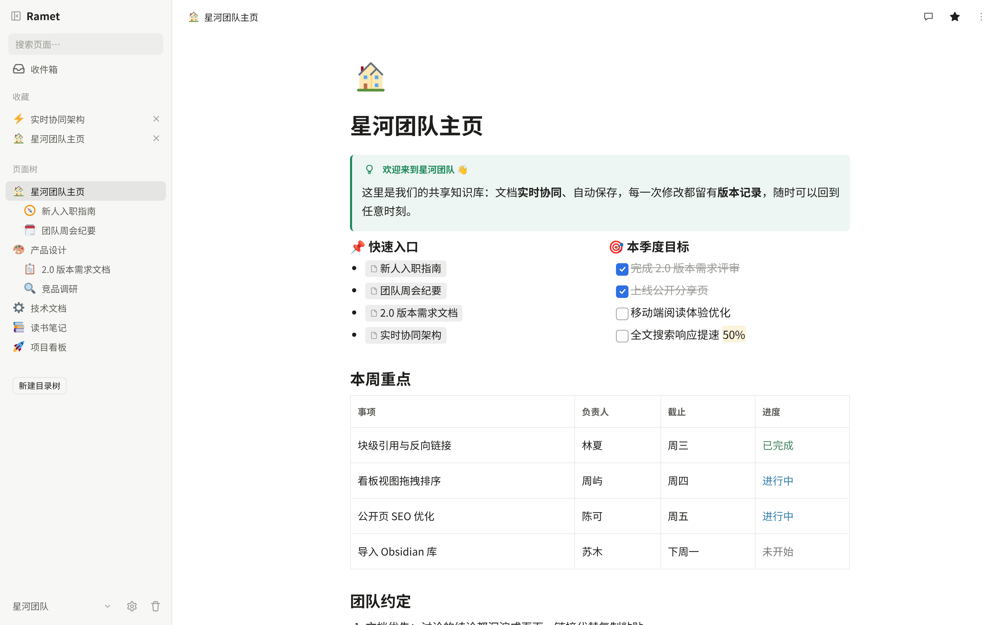
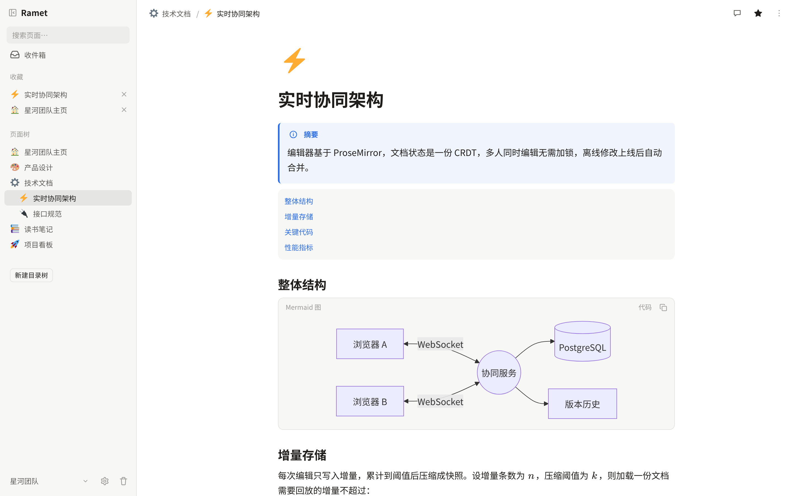
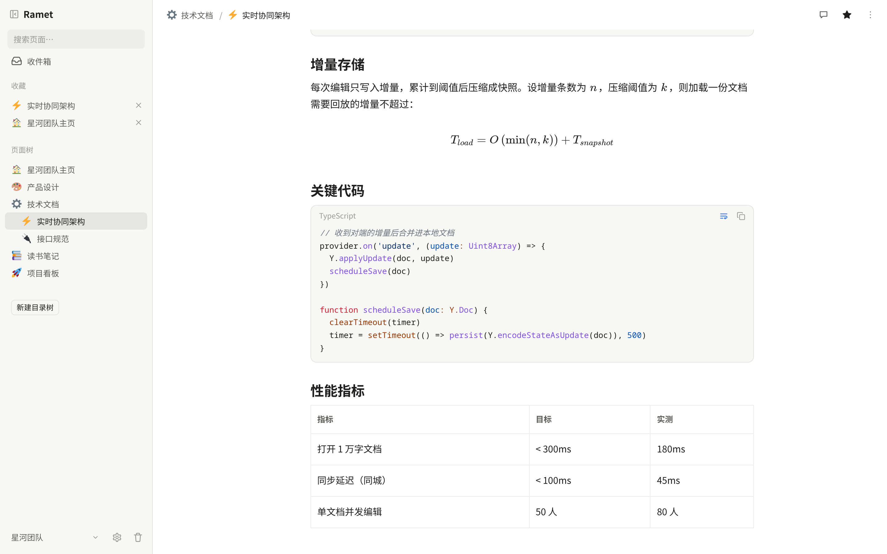
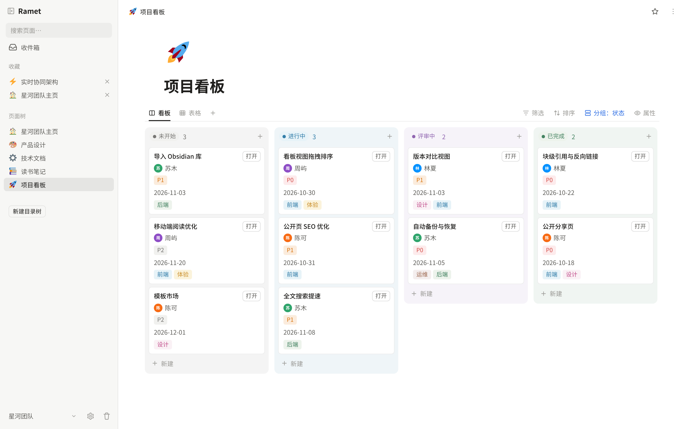
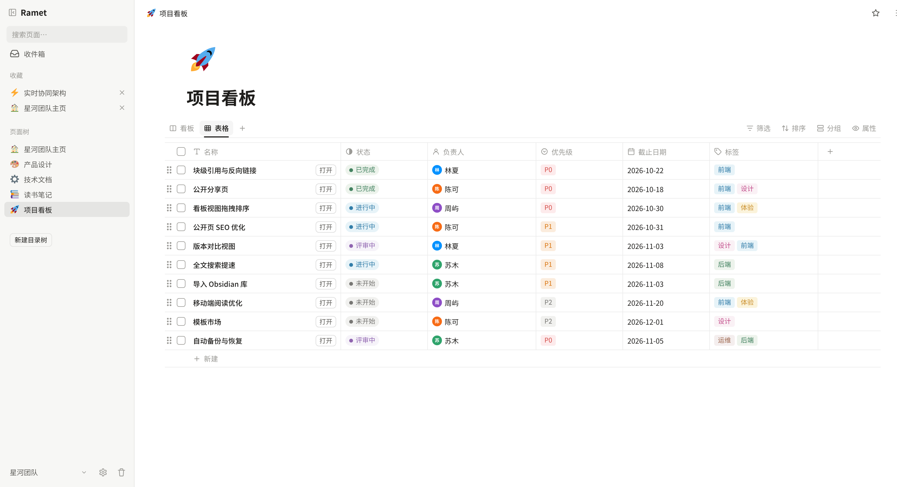
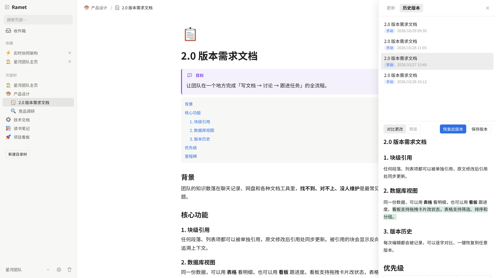
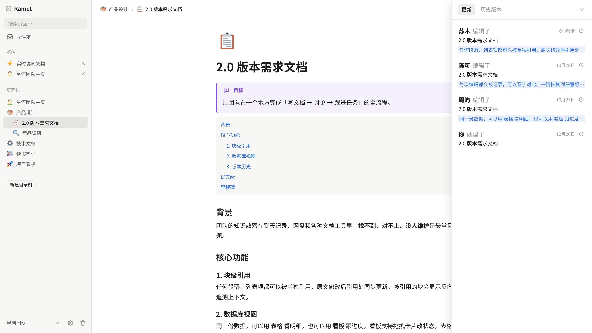
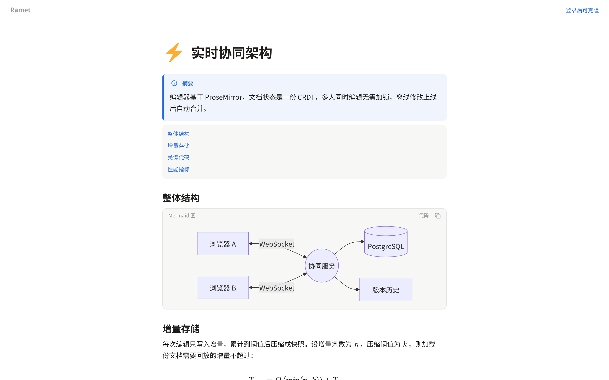
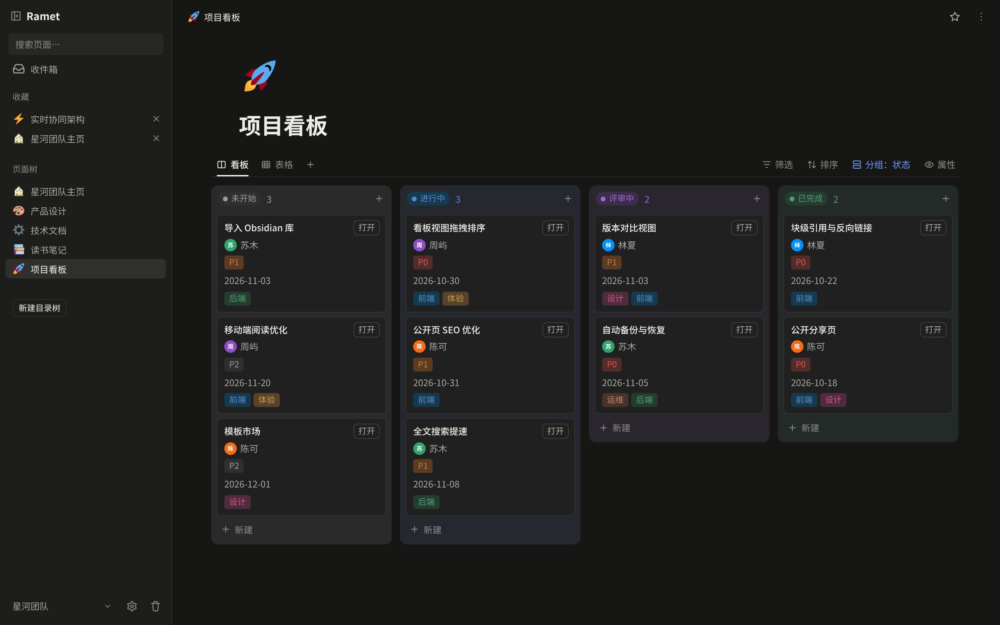

<div align="center">


# Ramet

**可自托管的多人协作 Markdown 知识库**

页面树 · 块编辑 · 实时协同 · 永久版本历史 · 数据在你自己的 Postgres 里


[English](README.md) · **简体中文**

[功能](#功能) · [部署](#部署) · [配置](#配置)

</div>

<p align="center">
  
</p>

---

## 功能

### ✍️ 说 Markdown 的块编辑器

- 基于 Milkdown：`/` 斜杠菜单、块手柄拖拽、表格、代码高亮、公式、Mermaid 图、提示块、图片与附件、子页面、同步块
- 整页源码模式，直接改 Markdown
- 基于 Yjs 的多人实时协同，看得见彼此的光标
- `@` 提及、`[[` 双链、块链接与反向链接；块有稳定 id，改写 Markdown 再写回时引用不会悬空

<table>
<tr>
<td width="50%"></td>
<td width="50%"></td>
</tr>
</table>

### 🗂 集合：表格与看板

- 页面可以变成数据集合，用表格或看板查看
- 筛选、排序、分组、批量操作，卡片拖拽换列

<table>
<tr>
<td width="50%"></td>
<td width="50%"></td>
</tr>
</table>

### 🕰 每个版本都留着

- 版本快照永不删除，按块看差异，对比任意两个版本
- 恢复整版，或者只捞回某个被删的块
- 更新动态里能看到谁改了什么

<table>
<tr>
<td width="50%"></td>
<td width="50%"></td>
</tr>
</table>

### 🌐 能分享，也归你所有

- 空间与成员（owner / member / viewer）、邀请链接、收藏、回收站、全文搜索
- 单页对外发布，免登录访问
- 导出 zip（每页一个 `index.md` 加同目录资源）/ 导入 Markdown
- 深色模式，手机端可用

<table>
<tr>
<td width="50%"></td>
<td width="50%"></td>
</tr>
</table>

## 部署

需要 **Docker**，以及用来构建前端的 **Node.js 22+**。

```bash
git clone https://github.com/nsjsv/Ramet.git ramet && cd ramet
cp .env.example .env                # 按需填写，见「配置」；至少改掉 POSTGRES_PASSWORD
npm ci
npm run build -w packages/web       # 构建前端
docker compose -f docker-compose.prod.yml up -d --build
```

然后：

1. 打开 `http://<服务器>:8080`。**第一次访问会进入初始化页，在这里创建管理员账号**，部署后请尽快完成。
2. 管理员在后台创建其他账号（没有自助注册），然后在空间里邀请成员。

### 升级

拉代码、重新构建前端、重启：

```bash
git pull && npm ci
npm run build -w packages/web
docker compose -f docker-compose.prod.yml up -d --build      # 依赖没变时镜像走缓存
docker compose -f docker-compose.prod.yml restart server
```

数据库结构启动时自动更新，不需要手动迁移。

### 备份

全部数据就是 `./postgres-data` 和 `./uploads` 两个目录。上传的文件永不删除，因为历史版本还引用着它们。

## 配置

都写在仓库根目录的 `.env` 里，全部可选。模板见 [`.env.example`](.env.example)。

| 变量 | 作用 |
|---|---|
| `POSTGRES_PASSWORD` | 数据库密码，只在首次建库时生效，之后要改得进库里改 |
| `WEB_PORT` | 对外端口，默认 `8080` |
| `RAMET_IMGBED_URL` / `RAMET_IMGBED_TOKEN` / `RAMET_IMGBED_PUBLIC_URL` | 可选：把图片镜像到 [CloudFlare-ImgBed](https://github.com/MarSeventh/CloudFlare-ImgBed) 图床，读图时跳过去；本地仍保留正本 |

## 参与开发

开发环境与提交规范见 [CONTRIBUTING.md](CONTRIBUTING.md)。

**欢迎 AI 生成的 issue 和 PR，但必须标注。** 如果 issue 或 PR 全部或主要由 AI 撰写，请在描述末尾单独加一行注明，例如：

```
AI-generated (Claude Code)
```

## 许可证

[AGPL-3.0](LICENSE)。Emoji 图片来自 [Twemoji](https://github.com/twitter/twemoji)（CC-BY 4.0，见 `packages/web/public/twemoji-NOTICE.txt`）。
